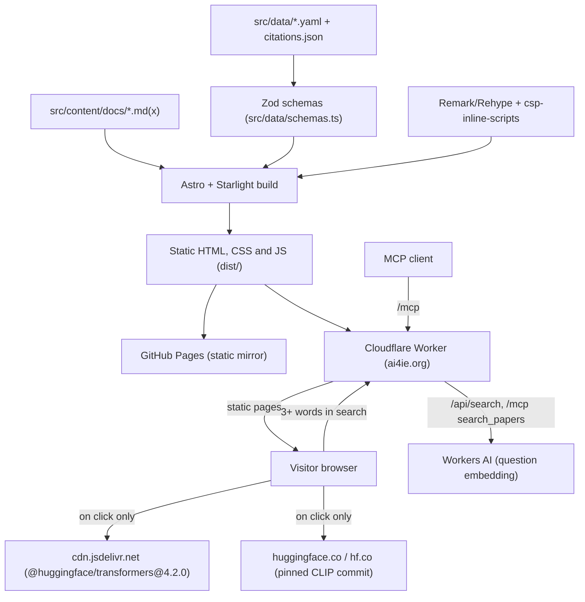

# Architecture

Last reviewed: 2026-11-21

Astro and Starlight build the static site. Cloudflare Workers serves it at <https://ai4ie.org/>
and handles `/api/search`, `/mcp`, `/api/contribute` and `/api/poll`. GitHub Pages
serves a static mirror.
The site has no accounts or analytics. See the [privacy page](src/content/docs/privacy.md) for
request logs, browser storage, and public submissions.

## Build and runtime flow

## Code layout

- `src/data/`: curated YAML data (`literature.yaml`, `applications.yaml`, `resources.yaml`), citation cache (`citations.json`), tag vocabulary (`vocabulary.yaml`, with the labels the code imports in `vocabulary.gen.ts` and `tags.ts`) and Zod schemas (`schemas.ts`).
- `src/lib/`: `skos.ts` (the vocabulary as SKOS) and pure helpers for citations, RSS feed, URLs, resource lists, Sankey geometry, chapter checks and stall detection.
- `src/components/`: static components (`AppList.tsx`, `TagChips.tsx`, `Resources.astro`), three React islands (`LiteratureBrowser.tsx`, `ApplicationsExplorer.tsx`, `ZeroShotDemo.tsx`) and their filter and pivot helpers.
- `src/plugins/`: Markdown and HTML build plugins, plus `csp-inline-scripts.mjs`.
- `src/content/docs/`: guide pages in Markdown and MDX.
- `worker/`: the Cloudflare Worker: `/api/search`, `/api/contribute` (`contribute.ts`), `/api/poll` (`poll.ts`), the MCP server (`mcp.ts`) and the shared search and rate-limit code (`search.ts`).
- `vocabulary/`: `context.jsonld`, the JSON-LD context shared byte for byte with the author's other site; the build serves the vocabulary at `/vocabulary.ttl` and `/vocabulary.jsonld` from it.
- `scripts/`: `vocabulary.mjs` (writes `src/data/vocabulary.gen.ts`), and build-time and CI checks (accessibility, licences, citations, page weight and social card).

## Security architecture and assurance case

The Worker reads JSON files from the build for search and `/mcp`. Contributions create public
GitHub issues. The poll's `POLL` Durable Object stores the option counts and voter count together
in one transaction.

1. **Repository and build pipeline (`PR -> main -> dist/`).**
   - *Threats:* malicious or malformed data entries, compromised dependencies, workflow injection and leaked secrets.
   - *Countermeasures:* Zod schemas and Vitest check every entry and module, while Biome, `astro check` and CodeQL check the code. `zizmor`, `actionlint`, `betterleaks` and GitHub secret scanning guard workflows and commits. `pnpm-lock.yaml` pins package hashes, workflows pin Actions by commit SHA, and jobs run with minimal permissions.
2. **Static site to visitor browser (`ai4ie.org -> browser`).**
   - *Threats:* cross-site scripting (XSS), script injection and man-in-the-middle tampering.
   - *Countermeasures:* Cloudflare Workers serves `ai4ie.org` over HTTPS and sets HSTS on static pages. Astro writes a Content Security Policy meta tag, and `src/plugins/csp-inline-scripts.mjs` adds SHA-256 hashes for inline scripts. None of the React islands render raw HTML.
3. **Optional in-browser CLIP demo (`ZeroShotDemo.tsx -> external hosts`).**
   - *Threats:* unexpected network traffic, leaking a visitor's photo and upstream model tampering.
   - *Countermeasures:* the demo loads external code and weights only after you pick a photo and click Classify. Your photo stays in browser memory (`URL.createObjectURL`) and never leaves the device. The code pins `@huggingface/transformers@4.2.0` in the CSP and pins `Xenova/clip-vit-base-patch32` to one commit SHA.

4. **Worker endpoints (`/api/search`, `/mcp`, `/api/contribute`, `/api/poll`).**
   - *Threats:* spending the Workers AI allowance, issue spam, poll flooding, cross-site calls from a browser page, and oversized input.
   - *Countermeasures:* search and `/mcp` share per-IP (per /64 for IPv6) and location-wide rate limits and cap queries at 300 characters; `/mcp` checks browser Origin and refuses JSON-RPC batches. `POST /api/contribute` and `POST /api/poll` share per-IP and location-wide rate limits. Both validate submissions and require Cloudflare Turnstile. Contribution requests require a GitHub Issues token and reject a separate email field. Poll requests require the `POLL` binding and the Turnstile secret. The poll stores only totals.

### Residual risks and non-goals

- GitHub Pages controls the response headers on the static mirror.
- Embedded Hugging Face Spaces on demo pages run in third-party iframes under Hugging Face's own origin.
