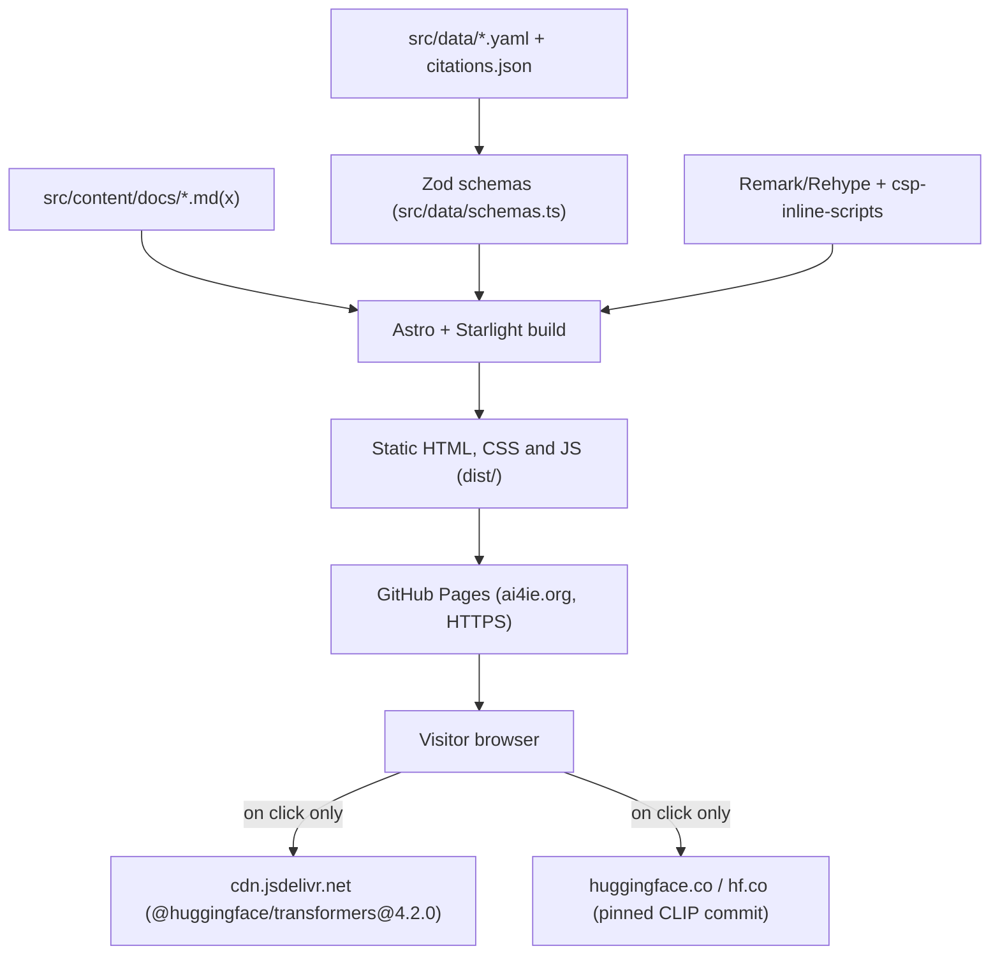

# Architecture

Last reviewed: 2026-11-19

Awesome AI for Industrial Ecology is a static site built with Astro and Starlight and hosted on GitHub Pages at <https://ai4ie.org/>. There is no backend server, database, user account system or analytics script.

## Build and runtime flow

## Code layout

- `src/data/`: curated YAML data (`literature.yaml`, `applications.yaml`), fetched citation cache (`citations.json`), shared tag vocabulary (`tags.ts`), and Zod schemas (`schemas.ts`).
- `src/lib/`: pure helpers for author/citation formatting (`literature.ts`, `citations.ts`), URL construction (`urls.ts`), Sankey geometry (`sankey.ts`), chapter checks (`chapters.ts`) and stall detection (`stall.ts`).
- `src/components/`: static Astro/React components (`AppList.tsx`, `TagChips.tsx`) and three interactive React islands (`LiteratureBrowser.tsx`, `ApplicationsExplorer.tsx`, `ZeroShotDemo.tsx`) plus their pure filter/pivot helpers (`litFilter.ts`, `appPivot.ts`).
- `src/plugins/`: Markdown/HTML build plugins (`remark-base-links.mjs`, `rehype-focusable-tables.mjs`, `rehype-task-list-labels.mjs`) and the post-build CSP hasher (`csp-inline-scripts.mjs`).
- `src/content/docs/`: guide pages in Markdown/MDX.
- `scripts/`: build-time and CI checks (`a11y.mjs`, `check-licenses.mjs`, `fetch-citations.mjs`, `page-weight.mjs`, `og-card.mjs`).

## Security architecture and assurance case

Because the site is static with no server-side state, the attack surface sits at three trust boundaries:

1. **Repository and build pipeline (`PR -> main -> dist/`).**
   - *Threats:* malicious or malformed data entries, compromised dependencies, workflow injection, leaked secrets.
   - *Countermeasures:* Zod schema validation and unit tests (`vitest`), Biome lint and strict TypeScript (`astro check`), CodeQL default setup, `zizmor` and `actionlint` on workflows, `betterleaks` and GitHub secret scanning with push protection, `pnpm-lock.yaml` integrity hashes, GitHub Actions pinned by commit SHA, and minimal workflow `permissions`.
2. **Static site to visitor browser (`ai4ie.org -> browser`).**
   - *Threats:* cross-site scripting (XSS), script injection, man-in-the-middle tampering.
   - *Countermeasures:* HTTPS enforced on GitHub Pages and `ai4ie.org`; Astro's Content Security Policy meta tag augmented at build time by `src/plugins/csp-inline-scripts.mjs` with per-script SHA-256 hashes; no `dangerouslySetInnerHTML` or unsanitised HTML rendering in the React islands.
3. **Optional in-browser CLIP demo (`ZeroShotDemo.tsx -> external hosts`).**
   - *Threats:* unexpected network traffic, privacy leak of a visitor's image, upstream model tampering.
   - *Countermeasures:* external code and weights load only after the visitor selects a photo and clicks Classify; the visitor's photo stays in browser memory (`URL.createObjectURL`) and is never uploaded; `@huggingface/transformers` is pinned to an exact version URL allowed by the CSP, and `Xenova/clip-vit-base-patch32` is pinned to a specific commit SHA.

### Residual risks and non-goals

- GitHub Pages does not allow custom HTTP response headers, so `Strict-Transport-Security` is not sent (see [.github/SECURITY.md](.github/SECURITY.md#scope)).
- Embedded Hugging Face Spaces on demo pages run in third-party iframes under Hugging Face's own origin.
