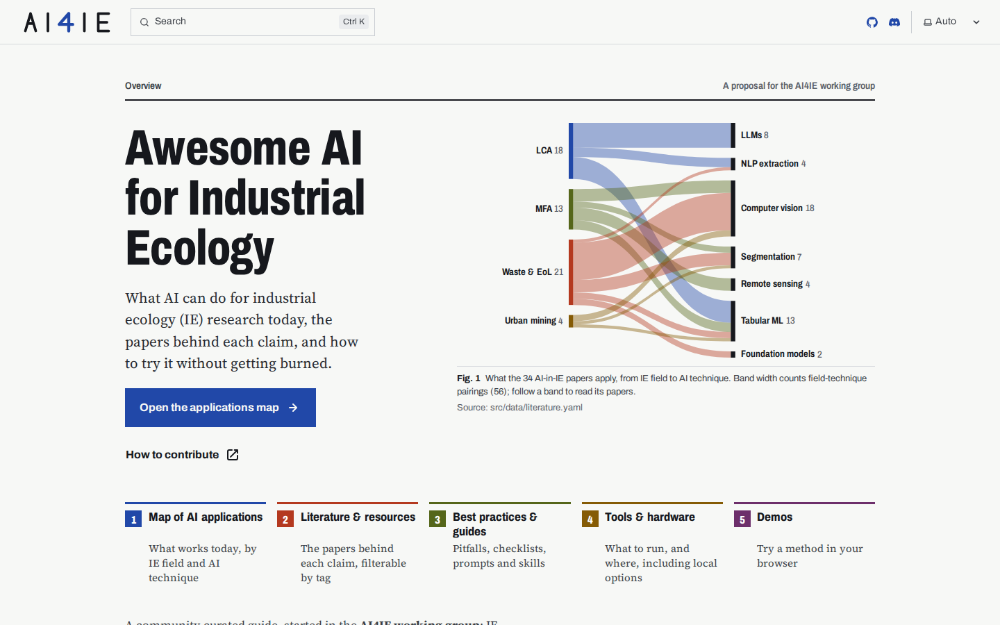

# Awesome AI for Industrial Ecology

A community-curated resource for using AI in industrial ecology (IE) research. It started in the AI4IE working group, and [anyone can contribute](CONTRIBUTING.md).

[](https://simonvanlierde.github.io/awesome-ai4ie/)
[](CONTRIBUTING.md)
[](https://discord.gg/zhHAZakXHX)
[](https://github.com/simonvanlierde/awesome-ai4ie/actions)
[](https://codecov.io/gh/simonvanlierde/awesome-ai4ie)
[](https://astro.build)
[](LICENSE)
[](LICENSE-CONTENT)

Each section already has real content to react to: an applications map, a literature list, tool and hardware guidance, working Claude skills, and in-browser demos.

**See it live: [simonvanlierde.github.io/awesome-ai4ie](https://simonvanlierde.github.io/awesome-ai4ie/)**

<a href="https://simonvanlierde.github.io/awesome-ai4ie/">
  
</a>

## Quick start

You don't need a local setup to edit text. To preview the site (needs Node 26+):

```bash
npm install
npm run dev        # → http://localhost:4321/awesome-ai4ie/
npm test
```

## Links

- [Live site](https://simonvanlierde.github.io/awesome-ai4ie/)
- [Site pages](src/content/docs/) and their data in [`src/data/`](src/data/)
- [Contributing guide](CONTRIBUTING.md)
- [AI4IE Discord](https://discord.gg/zhHAZakXHX)

## License

The code is under the [MIT License](LICENSE). The content is under
[CC BY 4.0](LICENSE-CONTENT): the pages in `src/content/`, the YAML data in `src/data/`,
the skills in `skills/`, and the images in `src/assets/` and `public/`.
