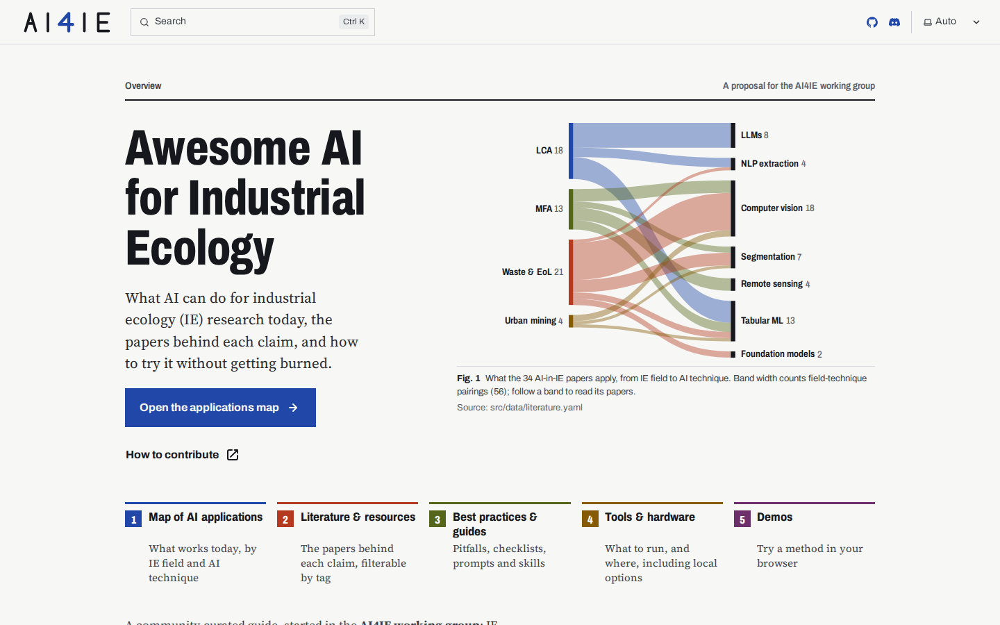
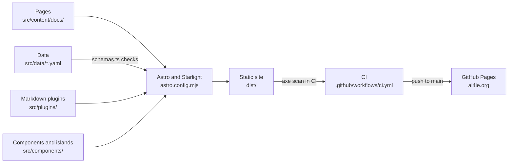

<h1> Awesome AI for Industrial Ecology</h1>

A community-curated guide to using AI in industrial ecology (IE) research. Industrial ecology studies how materials and energy move through the economy: what products are made of, where they end up, and what that costs the environment. The guide has an applications map, a literature list, tool and hardware guidance, working Agent Skills, and in-browser demos. It started in the AI4IE working group, and [anyone can contribute](CONTRIBUTING.md). To suggest a paper, a [short form](../../issues/new?template=paper.yml) is enough.

[](https://ai4ie.org/)
[](CONTRIBUTING.md)
[](https://discord.gg/zhHAZakXHX)
[](https://github.com/simonvanlierde/awesome-ai4ie/actions)
[](https://codecov.io/gh/simonvanlierde/awesome-ai4ie)
[](https://www.bestpractices.dev/projects/16926)
[](https://astro.build)
[](LICENSE)
[](LICENSE-CONTENT)

**See it live: [ai4ie.org](https://ai4ie.org/)**

<a href="https://ai4ie.org/">
  
</a>

## Development

You need Node 26 and pnpm. To build the site and run the checks:

```bash
pnpm install
pnpm run check
pnpm run lint
pnpm test
pnpm run build
```

Preview it with `pnpm run dev`, at <http://localhost:4321/>. The pages are in [`src/content/docs/`](src/content/docs/) and their data is in [`src/data/`](src/data/). To ask a question, join the [AI4IE Discord](https://discord.gg/zhHAZakXHX). Found a bug or a broken link? [Open an issue](../../issues/new/choose). To report a vulnerability privately, see [SECURITY.md](.github/SECURITY.md). Maintainers: see [MAINTAINING.md](MAINTAINING.md).

## How it works

[Astro](https://astro.build) with the Starlight docs theme builds a static site. Pages are Markdown and MDX. The papers and applications are YAML files that Astro reads into typed collections, so a field, tag or reference that does not fit fails the build or `pnpm test`. React islands add the filterable lists, the map explorer and the in-browser demos.



- [`src/data/schemas.ts`](src/data/schemas.ts) defines the shape of an entry, and [`src/data/tags.ts`](src/data/tags.ts) the tag vocabulary that the entries, the issue forms and the home page's Fig. 1 share.
- [`src/lib/`](src/lib/) holds the logic that has tests: filtering, the Sankey layout and the chapter list.
- [`src/components/overrides/`](src/components/overrides/) replaces Starlight's head, hero, page title and footer.
- [`scripts/a11y.mjs`](scripts/a11y.mjs) runs axe over every built page. CI deploys to GitHub Pages only after the checks, the build and that scan pass.

## License

The code is under the [MIT License](LICENSE). The content is under
[CC BY 4.0](LICENSE-CONTENT): the pages in `src/content/`, the YAML data in `src/data/`,
the skills in `skills/`, and the images in `src/assets/` and `public/`.
