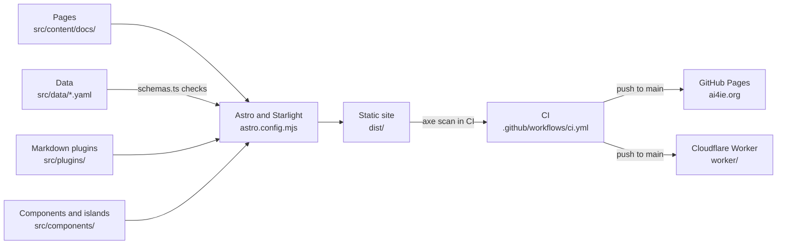

<h1> Awesome AI for Industrial Ecology</h1>

[ai4ie.org](https://ai4ie.org/) lists papers, applications and practical guides on AI for industrial ecology. It is a proposal for the AI4IE working group. You can [suggest a paper](../../issues/new?template=paper.yml) or [contribute on GitHub](CONTRIBUTING.md).

[](https://github.com/simonvanlierde/awesome-ai4ie/actions)
[](https://codecov.io/gh/simonvanlierde/awesome-ai4ie)
[](https://www.bestpractices.dev/projects/16926)

## Development

You need Node 26 and pnpm. To build the site and run the checks:

```bash
pnpm install
pnpm run check
pnpm run lint
pnpm test
pnpm run build
```

Preview it with `pnpm run dev`, at <http://localhost:4321/>. The pages are in [`src/content/docs/`](src/content/docs/) and their data is in [`src/data/`](src/data/). To ask a question, join the [AI4IE Discord](https://discord.gg/zhHAZakXHX). Found a bug or a broken link? [Open an issue](../../issues/new/choose). To report a vulnerability privately, see [SECURITY.md](.github/SECURITY.md). Maintainers: see [MAINTAINING.md](MAINTAINING.md).

## How it works

[Astro](https://astro.build) with the Starlight docs theme builds a static site. Pages are Markdown and MDX. Papers, applications and resources are YAML files that Astro reads into typed collections, so a field, tag or reference that does not fit fails the build or `pnpm test`. React islands add the filterable lists, the map explorer and the in-browser demos.



- [`src/data/schemas.ts`](src/data/schemas.ts) defines the shape of an entry, and [`src/data/vocabulary.yaml`](src/data/vocabulary.yaml) the tag vocabulary that the entries, the issue forms and the home page's Fig. 1 share. The site lists it at [/vocabulary/](https://ai4ie.org/vocabulary/), also as SKOS.
- [`src/lib/`](src/lib/) holds the logic that has tests: filtering, the Sankey layout and the chapter list.
- [`src/components/overrides/`](src/components/overrides/) customises Starlight’s head, home page, search and footer.
- [`scripts/a11y.mjs`](scripts/a11y.mjs) runs axe over every built page. CI deploys to GitHub Pages only after the checks, the build and that scan pass.

## MCP server

A read-only [MCP](https://modelcontextprotocol.io) server runs on the site's Worker at `/mcp` (Streamable HTTP, no authentication, no sessions): `https://awesome-ai4ie.simonvanlierde.workers.dev/mcp` now, and `https://ai4ie.org/mcp` once ai4ie.org moves to the Worker. It returns papers, applications, resources and skill files.

| Tool | Returns |
| --- | --- |
| `search_papers(question)` | Up to 5 papers close in meaning to a question (at most 300 characters) |
| `get_paper(id)` | One paper's authors, DOI or arXiv id, tags, link and BibTeX |
| `list_applications(id?, field?, technique?)` | Applications with a link to each on the map, filtered by id, IE field (`lca`, `sem`, `eeio`, `circular`, `symbiosis`) and ML technique |
| `list_resources(id?, kind?, field?, topic?)` | Tools, datasets, courses and other resources, filtered by id, kind, IE field and topic |
| `get_skill(name)` | The `SKILL.md` text of one Agent Skill |

`search_papers` is the search dialog's meaning search: the same code, the same limit of 30 questions a minute per IP address (per /64 for IPv6), and the same path for the question, which goes to Cloudflare Workers AI and is not stored ([privacy](src/content/docs/privacy.md)). Both share that limit, so heavy use from one address slows the dialog too. When search is down it returns a tool error, not an empty list; every tool error is JSON with a stable `error` code: `not_found`, `rate_limited` or `unavailable`. Paper ids for `get_paper` come from `search_papers` and `list_applications`. Every tool but `get_skill` declares an output schema and returns its JSON as structured content too. A retired tag id, such as `mfa`, still filters: it maps to its replacement in the [vocabulary](src/data/vocabulary.yaml), and one with no replacement returns `not_found`.

Add it to a client, for example Claude Code: `claude mcp add --transport http ai4ie https://awesome-ai4ie.simonvanlierde.workers.dev/mcp`. Other clients take the same URL as a remote server; only Claude Code has been tested. A client outside a browser sends no Origin header and is always let in; a browser page may call only from the server's own host or localhost. The code is in [`worker/mcp.ts`](worker/mcp.ts); it reads the papers from `literature-index.json`, as `/api/search` does, and the rest from `mcp-data.json`.

The server reports the version set in `worker/mcp.ts` (now 1.0.0). It versions the tool contract, not the site, and changes only in a release, with a CHANGELOG entry: the minor number when a tool, an argument or a field is added, the major number when one is removed or renamed or changes meaning.

## License

The code is under the [MIT License](LICENSE). The content is under
[CC BY 4.0](LICENSE-CONTENT): the pages in `src/content/`, the YAML data in `src/data/`,
the skills in `skills/`, and the images in `src/assets/` and `public/`.
